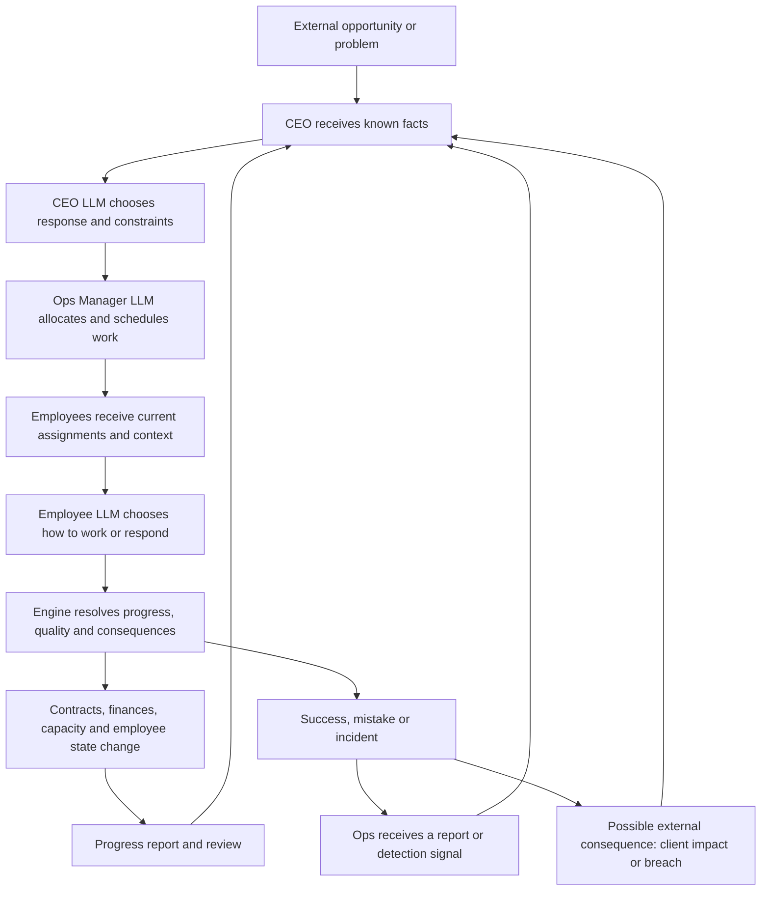

# Events and autonomous business operation: implementation plan

Status: planning only. No application code changed.

Prepared 7 November 2026 against the current repository. This plan replaces the existing billboard-shock model with an autonomous B2B software/services business whose events have causes, owners, decisions, work and consequences.

## 1. Agreed product decisions

| Area | Decision |
| --- | --- |
| Control | The AI runs the business. The CEO LLM decides how to respond; there is no player approval step. |
| Organisation | Keep the eight-person cast: CEO → Ops Manager → six employees across Sales, Engineering and Operations. |
| Common events | One new common root event approximately every 2–4 active workdays: 10–20 ticks. |
| Rare events | One new rare root event approximately every simulated month: around 50 ticks. |
| Tone | Target approximately 60% positive and 40% negative events in a healthy baseline business. |
| Business | B2B software/services, with actual contracts, revenue, costs and delivery capacity. |
| Client-win example | A common client win can contribute 10% of Sales’ fixed quarterly revenue target. |
| Layoffs | A rare cost-cutting/layoff situation may arise randomly. The CEO can choose alternatives to layoffs. An actual layoff occurs only if the CEO chooses and executes it. |
| Employee causality | Employees can produce successes and mistakes that create business events, including a data breach. |
| Reaction | CEO decisions must change real assignments and reach subsequent employee LLM calls before those employees act. |
| LLM integration | Extend the actual request contexts, response schemas, validators and executable actions for CEO, Ops and employee calls; prompt wording alone is insufficient. |
| End-of-run reporting | Retain the complete event/decision/outcome history and automatically generate an evidence-based AI business report when a run completes. |

The referenced photo was not attached. The flow below implements the written description; reconcile it with the photo if it supplies additional relationships.

## 2. What the current implementation gets wrong

These findings come from executable code, rather than older handoff documents, some of which describe an earlier implementation.

| Current behaviour | Location | Required change |
| --- | --- | --- |
| Seven event types; only `surprise_bonus` is clearly positive. Several templates describe extreme policies. | `shared/types.ts`, `server/params.ts` | A broader catalogue of plausible opportunities, routine successes, manageable problems and occasional major changes. |
| A shuffled deck emits a first event at ticks 1–4, then every 22–26 ticks. No rarity or business eligibility. | `server/scripts/fixture.ts:buildScenario` | Stateful common/rare scheduling with preconditions and cooldowns. |
| Events directly mutate workload, stress and trust; the CEO makes no management decision. | `server/rules.ts:applyEvent` | Separate arrival effects from decisions, assignments and execution effects. |
| CEO and Ops use the same eight social/work actions as staff. Profiles have no reporting relationship. | `server/bias.ts`, `server/engine-types.ts` | Explicit authority and distinct executive, management and employee decision contracts. |
| All eight LLM calls see the start-of-turn snapshot and run together. | `server/tick.ts:runTick` | Ordered CEO and Ops phases, followed by concurrent employee calls. |
| `buildContext` includes every current event in every agent’s announcements, even when a rumour was delivered to only one hearer. | `server/tick.ts:buildContext` | Build context from recipient knowledge, not the global event list. |
| The prompt emphasises tired, impulsive people; job responsibilities, current assignments and capacity are absent. | `server/llm/prompt.ts` | Role-aware prompts with normal professional behaviour, bounded personality differences and current work. |
| Revenue, contracts and task capacity do not exist; price is a separate output/news model. | `server/price.ts`, `server/engine-types.ts` | A small business ledger and work model, with an explicit valuation integration. |
| An official event’s direct effects apply regardless of its hidden truth flag. | `server/rules.ts:applyEvent` | False information can affect belief; it cannot create a real contract, pay a bonus or remove a job. |
| Custom text inherits an unrelated preset’s numerical effects. | `shared/customEvent.ts`, `server/index.ts` | Structured, validated custom situations with consistent effects. |
| Events are headline strings; the banner shows only the last event received and disappears after ten seconds. | `shared/api.ts`, `src/announcement.ts` | Persistent event records and a readable decision-to-outcome history. |

Preserve useful foundations: cloned tick state, seeded RNG, bounded retries, deterministic rules, the single in-flight tick guard, reset generation checks, SSE history recovery and the existing office presentation.

## 3. The business loop

The CEO owns the response, but a speech does not resolve an event. Resolution requires observable work or a completed business decision. Some outside outcomes remain beyond the CEO’s control: a vendor can still be down after the company has done everything it can.

External events reach the CEO as accountable decision owner. Employee reports normally travel through Ops. An urgent security report may alert the CEO and Ops together; a pre-authorised containment action may happen immediately and is recorded in that chain. The hierarchy must not require staff to keep exposing data while waiting for a meeting.

### Three example stories

**Client win.** Sales develops an existing opportunity → the client signs a contract worth 10% of Sales’ frozen quarterly target → CEO chooses service priority and budget → Ops assigns onboarding and implementation work → employees receive those assignments in fresh prompts → work consumes capacity and costs money → contractual delivery earns recognised revenue and later cash. A delayed onboarding can threaten the contract; a good delivery can improve renewal prospects.

**Employee-caused breach.** An engineer works on a deployment with an actual configuration risk → a seeded quality outcome produces a permission mistake → exposure exists but is not automatically known to everyone → monitoring or a report detects it → Ops escalates known evidence → CEO chooses containment, investigation and client communication → Ops pauses lower-priority work and assigns remediation → employee prompts contain the new priorities → containment stops further exposure; recovery and customer consequences continue separately. Neither a careless-sounding line nor a `leak` action automatically proves a technical breach happened.

**Random rare cost-cutting situation.** The scheduler introduces a plausible new pressure, such as a required operating-budget reduction → CEO sees the amount, finances, capacity and alternatives → LLM can reduce discretionary spend, renegotiate costs, postpone work or choose layoffs → the engine validates feasibility → Ops executes the chosen plan. If layoffs are chosen, a particular occupied role exits, payroll and capacity change, and its work is reassigned. If an alternative meets the target, record “layoffs avoided”; never announce an actual layoff before it happens.

## 4. Separate event concepts that currently blur together

An event needs independent dimensions:

- **Origin:** external development, employee outcome, management decision, or player injection.
- **Rarity:** common or rare. This controls background generation, not severity.
- **Severity:** low, medium or high. A common client win may be financially meaningful; a rare milestone can be positive.
- **Valence:** positive or negative at the root business situation. Keep mixed consequences in the outcome record rather than forcing every employee to feel the same way.
- **Domain:** sales, delivery, reliability, security, finance, people or supplier.
- **Knowledge:** ground truth, detected evidence, official communication and rumour are separate records.

The event catalogue defines possible situations. An event instance represents one occurrence. A claim describes what a person believes about an occurrence. A directive is an authorised management instruction. An assignment is executable work. A ledger entry is a committed financial effect. None of these substitutes for another.

For example, “the company is cutting jobs” may be a false rumour about a real cost review. It can lower trust without changing payroll. A confirmed layoff is a separate executed decision linked to the same story.

## 5. Common and rare scheduling

Use `shared/workday.ts` as the single timing source. Five ticks are one active workday; ten active workdays/fifty ticks are one month. Two routine calendar days are skipped after each active workday. UI copy must distinguish active workdays from calendar days and stop calling every tick “one hour” where the actual clock advances by two hours.

### Arrival rules

| Stream | Initial tuning | Notes |
| --- | --- | --- |
| Common background situations | Seeded interval of 10–20 ticks, average 15 | Approximately 3.3 per month and 10 per quarter. First arrival follows a short orientation period within this window. |
| Rare background situations | Seeded interval of 40–60 ticks, average 50 | Approximately one per month and three per quarter, without forcing one on an exact date. |
| Employee-generated consequences | Evaluated when relevant work resolves | Not an independent random event rolled for every employee every tick. |
| Follow-ups and resolutions | Driven by deadlines, work and evidence | Do not consume a new root-event slot or count as a new positive/negative root. |

Use separate RNG namespaces for common arrivals, rare arrivals, template choice, work quality, detection and external consequences. Playback speed, model latency and run-length extension must not alter earlier arrival draws.

On each arrival, select only eligible templates: required client/opportunity/system exists, appropriate staff remain, financial prerequisites hold, and no contradictory case is already open. A rare cost-review template can itself introduce new pressure without requiring a pre-existing failing business, as requested.

Sample an eligible event’s valence around 60/40, then its family and details. Use a mild recent-history correction to avoid long streaks; do not force every five events into an identical three-positive/two-negative pattern. If no template of the desired valence is plausible, defer briefly or choose another eligible situation and record why. Do not invent revenue or a crisis to meet the ratio.

The 60/40 target applies to root events in healthy baseline runs, including attributed work outcomes. Measure scheduled roots and employee-generated roots separately as well as together. Suppress duplicate background wins when employees have just produced a real win; never suppress a real breach because the negative quota is full. A business run badly may have more negative outcomes. This must be a documented consequence of causality, not a hidden promise of constant good news.

### Pacing and repetition

- Start with at most one new scheduled root per active day and two simultaneous high-severity cases. Defer background arrivals when these limits are reached; do not hide urgent causal consequences.
- Set family-specific cooldowns: an enterprise renewal, a cost review and a supplier outage cannot repeatedly target the same entity without a reason.
- Keep common and rare timers independent; a common arrival must not reset the monthly timer.
- Generate successes from real work. When no eligible pipeline exists, introduce an opportunity rather than announcing that an imaginary customer has already signed.
- Reuse an open case for deterioration, recovery and updates. A breach, its customer complaint and its remediation must not become three unrelated breaches.
- Consume a scheduled slot at most once. A deferred slot retains its identity; no burst of overdue events after a pause or busy period.
- Count material employee-generated roots against the next background slot of the same rarity, postponing that background arrival to preserve the overall pace. Ordinary task completions remain progress updates unless they meet a meaningful business threshold. Genuine urgent consequences may exceed the intended pace; show and measure that overload rather than hiding it.

## 6. Initial catalogue

Build 24 fully specified templates before adding headline variety. Every template needs eligibility, evidence, owner, response options, required work, success/failure conditions, financial effects, deadlines, cooldowns and tested fallback behaviour. Catalogue counts alone do not determine the 60/40 sampling ratio.

| Rarity | Positive situations | Negative situations |
| --- | --- | --- |
| Common: Sales | A qualified client signs; existing client expands usage; a standard renewal completes | A proposal misses a requirement; a client raises a delivery concern |
| Common: Engineering | A release meets acceptance criteria; an optimisation reduces recurring infrastructure cost; a well-tested fix removes recurring support work | A release regression; a risky access/configuration mistake |
| Common: Operations | Onboarding finishes successfully; an invoice is collected; a supplier discount is secured; a process improvement reduces rework | A supplier interruption; an invoice becomes overdue |
| Rare: cross-company | A strategic partnership signs; a flagship product launch succeeds; a major multi-year account renews; a large client adopts the product company-wide | A randomly introduced cost-reduction/layoff review; a confirmed material data breach; a major account threatens to leave; a critical supplier withdraws service |

That is sixteen common templates and eight rare templates. A common configuration error is not always a confirmed material breach: exposure, scope, detection and consequences determine escalation. A rare breach can also start from an external supplier incident, with its source stated explicitly.

Some families have both common and rare forms, such as a standard renewal versus a company-defining renewal. Give them separate eligibility thresholds and prevent both variants from firing for the same contract. A material incident promoted from an existing common case consumes rare pacing allowance without becoming a duplicate root or counting twice toward valence.

Do not schedule “successful launch” unless launch work really met its criteria. A rare opportunity may arrive randomly; its success must be earned. Seed a modest existing pipeline, customer base and ongoing work so the company feels established rather than generating accomplishments from nothing.

Remove extreme working-hours headlines from routine rotation. Overtime can be an explicit, bounded CEO/Ops choice with workload, recovery, quality and employee consequences; it must correspond to work the simulation actually models.

## 7. Authority and autonomous decisions

### CEO

The CEO LLM receives current known business facts, active cases, the financial position, options that are actually executable, capacity constraints and Ops reports. It chooses a concrete strategy, not merely a public statement.

The structured decision includes: addressed event IDs, selected option IDs, priorities, accountable manager, budget envelope, deadlines, acceptance criteria, communication scope, review time and a short rationale. Values must stay inside engine-supplied bounds. Options can combine compatible measures; the LLM may explain trade-offs but cannot invent staff, contracts or cash.

Examples: prioritise retention over new sales; pause a rollout; fund a security review; negotiate a deadline; cap overtime; reduce tooling spend; approve a voluntary bonus; initiate a layoff. The engine validates and applies the chosen business command. It does not randomly replace a valid executive choice with gossip or slacking off.

### Ops Manager

Ops receives the committed CEO directive and fresh capacity/dependency information. Its LLM selects named employees, work allocation, task sequence, review requirements and what work to pause. It reports infeasibility instead of inventing capacity. Major spending, structural changes and layoffs require CEO authority; task scheduling within an existing envelope does not need another CEO call.

### Employees

The six employees retain personality, emotion and agency. Their LLM chooses effort, care, escalation, collaboration or disengagement in the context of assigned work. A low-trust employee may question a directive or work reluctantly; a high-trust employee may follow it. Relevant assignments must still exist in their prompt and available actions.

Introduce a small, role-aware execution vocabulary: perform an assigned task, review work, report/escalate an issue, and support a colleague. Retain existing social actions where valid. Do not add a separate action for every event template; task kinds supply the domain. Targeted work proposals identify a valid task and, when needed, an authorised colleague.

Work capacity is finite. Meetings, reviews, remediation, gossip and interviews use time; they cannot run alongside a full allocation of delivery work at zero cost. CEO and Ops also have finite management capacity. Avoid charging a management decision and a second unrelated full-turn action to the same person.

If the CEO is absent or quits, Ops becomes acting owner under a defined limited mandate. If Ops is absent, CEO temporarily delegates directly. If both are absent, use existing emergency procedures and pause discretionary new commitments; do not invent a ninth employee. An empty company continues its outstanding accounting and shows it cannot deliver.

## 8. Tick ordering and fresh LLM information

Replace the current flat parallel turn with these explicit phases:

1. **Open tick.** Clone committed state; advance the canonical calendar; accrue due ledger items; expire directives; activate due reports and scheduled arrivals. Freeze a run-generation and phase revision.
2. **Detect and route.** Materialise evidence known now. Deliver relevant external cases to CEO and employee reports to Ops/CEO according to authority and urgency.
3. **CEO phase.** If a new case, deadline, material report or scheduled review requires a decision, call the CEO LLM on this revision. Validate and commit its decision in the working state.
4. **Ops phase.** Call Ops when the CEO changed a directive, capacity changed, a task needs scheduling or an operational report requires action. Build its prompt after the CEO commit. Commit valid assignments and pauses.
5. **Employee phase.** Build all six employee contexts after both management phases. Call active employees concurrently against this shared phase snapshot. New CEO/Ops assignments are already visible. Validate proposals and apply the existing bias process only to supported employee actions.
6. **Execution phase.** Resolve employee actions, resource contention, progress, quality and direct consequences using seeded rules. Produce reports, detected incidents and external effects. Prevent double allocation of the same capacity or task completion.
7. **Close tick.** Apply passive wellbeing/recovery and exits, recompute capacity, commit finance/valuation updates once, and emit an atomic tick frame and audit records.

An event known before the CEO phase can change employee behaviour in the same tick. An error first created during employee execution is normally reported and acted on in the next tick. Immediate bounded containment may run in phase 6 under standing authority, but do not recursively call CEO → Ops → employees until the incident disappears. This gives a clear causal order and a bounded LLM budget.

A material change arriving after a phase starts is queued for the next eligible phase/tick. Every decision is tagged with the state revision it read. Revalidate recipients, money and assignments before committing; reject a stale response instead of applying it to a reset or departed employee.

### Prompt contents and memory

Each prompt contains its current role, supervisor, authority, assigned work, priorities, deadline, relevant directive and version, known event evidence, previous outcome/report, and current emotional state in the existing bands. Include business numbers where decisions require them; emotional-band rules do not prohibit financial amounts or dates.

Staff see only the business information necessary for their work, official communications delivered to them, and claims they actually hold. The CEO is not omniscient about an undetected breach. Ops is not automatically informed by a private employee thought. Rumours do not arrive as official directives.

Keep active directives and unresolved commitments in a bounded memory. Summarise older completed stories deterministically; never truncate the current assignment, a new instruction or a critical report to make room for old gossip. Archive resolved claims and de-duplicate retellings.

Replace the universal tired-person opening with role-specific professional framing. Normal work should be the baseline, with stress, trust and personality changing choices. Existing prompt tests that lock in the old opening must be intentionally updated. Preserve authored persona text unless a change is explicitly needed; compose role instructions around it.

For every material directive/assignment change, affected agents must get a new LLM call before their next action in LLM mode. Any future cache must key the full rendered context, schema/prompt version and model, including directive versions and knowledge state. A stale cached decision must never bypass this requirement.

### Failures and latency

Keep one validation retry and bounded transport timeouts. On failure, use a role-specific deterministic fallback that obeys the same permissions and business constraints. Failed CEO calls preserve current policy and may invoke an existing emergency playbook; they do not initiate discretionary layoffs. Failed Ops calls preserve or safely reallocate feasible tasks. Employee failures use valid role/task actions. Log the exact affected phase and fallback.

Batch multiple incoming cases into one CEO decision, with explicit prioritisation of conflicts. Call CEO/Ops on material changes or review cadence rather than for every routine staff action. With the current cast, a routine tick needs six employee calls; a management tick normally needs one CEO, one Ops and six employee calls, plus bounded retries. Compare this to the current eight parallel calls: management ticks now have three sequential LLM stages and therefore longer latency. Playback speed is a scheduling preference, not a guaranteed real-time simulation rate. Expose a restrained “CEO deciding”/“Ops assigning” state without advancing simulated time mid-phase.

### LLM API requests, schemas and action execution

Changing the supported actions requires changes along the entire call path. The current `server/llm.ts` builds one employee-style prompt, `server/llm/parse.ts` extracts JSON, and `server/llm-adapter.ts` accepts only the existing action vocabulary. New action names would currently be dropped; new task-related fields would not survive the current schema/adapter. Therefore changing only the prompt cannot implement this design.

Keep the existing Anthropic transport, but add separate typed entry points for CEO decisions, Ops planning, employee turns and end-of-run report generation. Each supplies its own prompt, input/output schema, context revision, output-token budget and telemetry purpose. Shared transport and JSON extraction can remain reusable. Do not route a report or executive command through the employee proposal adapter.

| Call | Required request context | Required structured response |
| --- | --- | --- |
| CEO | Known open cases, available business options, finances, capacity summary, prior commitments and authority bounds | Selected business commands/options, addressed event IDs, budgets, priorities, deadlines, accountable manager, review conditions and rationale. |
| Ops | Committed CEO directives and versions, active employee capabilities/capacity, task dependencies and existing allocations | Assign/reassign/pause/resume/reprioritise work, allocate review/support capacity, report infeasible requests and escalate decisions outside its authority. |
| Employee | Current assignment IDs and versions, relevant event evidence, supervisor/directive, valid task/action combinations, available colleagues and claims | Weighted action proposals with typed task, report, event or colleague references where required; public/inner lines and beliefs remain separate. |
| End-of-run analyst | Frozen run facts, computed metrics and complete event story evidence, with source IDs | Structured report sections and evidence references. No commands, proposals or simulation mutations. |

Add a versioned decision envelope identifying the role/decision kind and state revision. Associate the request with authoritative run, tick and agent IDs on the server; never trust the model to select its own identity or authority. Reject a response intended for another role or revision.

Define employee actions concretely: retain `work`/`overwork` for execution against an assigned `task_id`, and add `review_work`, `report_issue` and `support_colleague` where the employee has a valid task, evidence and permissions. Preserve the existing social actions with their current meanings. A report action references known evidence or an observation generated by execution; it cannot manufacture a breach merely by naming one.

Use a discriminated schema for each action so required fields are enforced: a review references reviewable work; support references a colleague and relevant task; issue reporting identifies the subject and permitted recipients. Expose the allowed IDs and combinations in the prompt. Employee-only `weight` fields do not appear on executive commands. Keep valid CEO/Ops choices deterministic after validation instead of sampling them through employee action priors.

Update canonical action types/order, role-specific availability, prompts/examples, parsing/validation, proposal adaptation, bias priors/modifiers for added employee actions, target/task settlement, rule executors, fallback behaviour, templates, telemetry, API projections and UI action labels together. The current adapter merges proposals by action name; change the identity to include the relevant task/target/claim so two `work` proposals for different tasks do not silently become one incorrect proposal. Keep the three-proposal limit per employee turn unless measured scenarios justify changing it.

Schema validation is followed by contextual validation: does this assignment exist, can this employee act on it, is the budget feasible, and is the instruction still current? Distinguish rejected intent, validated model choice, the action finally selected by the employee bias engine, and its actual executed effect in the audit log. This distinction is also essential for the final report.

Version prompt/schema contracts and update the documented output contract and existing tests deliberately. Retain legacy action aliases only at a clearly tested compatibility boundary. Do not silently map an unsupported new management action to ordinary `work`. Preserve bounded retries and role-aware fallbacks, and test every new action through the real API-response parsing and execution path.

## 9. Real work, mistakes and business outcomes

Add a small work model before writing more event prose:

- A task has a responsible department, owner, effort, remaining work, dependencies, acceptance criteria, deadline, priority, review requirement and linked event/contract.
- An employee has role capabilities and finite work capacity. These are separate from personality traits; financial need or an archetype label must not itself make someone incompetent.
- `work` and `overwork` advance eligible assigned work. Review reduces avoidable defects but consumes capacity. Paused work stops advancing. No available task means idle/unallocated capacity, not fabricated productive output.
- Quality outcomes depend on relevant task exposure, skill fit, fatigue, workload, time pressure and controls. Every probability is parameterised and bounded; being stressed does not guarantee a serious failure.
- Separate making an error, detecting it, reporting it and causing customer impact. Each step has its own evidence and timing. Some errors are caught before external damage.
- Reported problems should sometimes produce positive learning: stronger checks, less rework and restored confidence. Concealment can delay detection and increase risk, but it is an employee choice with evidence, not an arbitrary personality punishment.
- Successful work can create renewals, client praise and savings. Preventive work must measurably reduce eligible incident risk, not simply generate reassuring dialogue.

Keep malicious disclosure (`leak`) distinct from accidental data exposure. A disclosure can create an external consequence only if there is relevant information, access and an actual external transmission. Gossiping a false claim may create reputational risk; it does not make the underlying allegation true.

Avoid unwinnable escalation loops: new work displaces old work, overtime has diminishing benefit, completed response tasks release capacity, temporary policy effects expire, and recovery is possible. The present trust-recovery damping and pressure-oriented action priors need recalibration against the healthier event mix; increasing positive headlines alone will not fix a permanently collapsing business.

## 10. Finances and capacity

Implement a deliberately small business ledger, not a complete accounting product.

| Model | Minimum fields/behaviour |
| --- | --- |
| Quarter plan | Frozen Sales quarterly revenue target, baseline business assumptions and quarter boundaries. |
| Opportunity | Client, value, sales stage, owner, expected close, requirements and capacity demand. |
| Contract | Client, signed value, term, delivery obligations, recognition schedule, payment terms and status. |
| Finance | Cash, bookings, recognised revenue, receivables, payroll, infrastructure/supplier costs, response costs and committed spend. |
| Capacity | Available employee time, booked task effort, forecast delivery dates, utilisation and department bottlenecks. |

For a Sales quarterly target of £1,000,000, the example deal is worth £100,000 of eligible revenue contribution. Store the reference quarter and frozen £1,000,000 denominator on the event. Do not repeatedly multiply the latest forecast by 1.10. Distinguish a signed booking from revenue earned through the contract and cash collected under its terms. If only £60,000 can be recognised this quarter, show that explicitly rather than claiming the full 10% has already been earned. Use configurable currency; the pounds here are illustrative.

Initialise existing contracts, recurring costs and receivables coherently. Wins must fit the sales pipeline and customer mix; not every common event is another 10% deal. Demand creates work. Understaffing can increase delays and risk even when revenue outlook improves.

Use integer minor currency units and ledger keys for exact-once effects. Fixed costs and contractual services accrue across skipped routine calendar days too: fifty ticks must represent thirty days of the chosen financial calendar, not ten days of payroll. Add a shared calendar-span helper so accounting, deadlines, quarter rollover and the displayed filler days agree. Skipped days can accrue deterministic routine obligations, but must not silently complete major response work or hide major incident decisions off-screen.

Check cash and commitments before spending. A negative cash position is a visible business state with financing/operating consequences; do not clamp it to zero or mint a bonus. Reductions in staffing change payroll prospectively and remove actual capacity. Layoffs, resignations and vacancies are distinct statuses and histories. Reassign or block abandoned work; cancelling a salary does not complete its tasks.

### Share price integration

Keep the existing deterministic price system, with isolated RNG. Add an explicit adapter from operating results and publicly known news. Do not double-count a contract as full immediate revenue, a permanent productivity boost and a repeated headline shock.

Record which inputs affect fundamentals and which affect news sentiment. Fundamentals may reflect real operating results before staff know the complete cause; public news impacts require an actual disclosure. Preserve price contribution diagnostics and add new event kinds to exhaustive validation. Payroll savings and lost capacity from layoffs must coexist in valuation; a layoff is not a universal positive or negative multiplier.

## 11. Event lifecycle and records

Use a compact primary lifecycle:

`open → responding → monitoring → resolved`

Terminal alternatives are `failed`, `cancelled` or `superseded`. Detection, escalation and awaiting-report are timestamped milestones rather than a second tangled set of primary states. Failure and supersession retain their history.

Minimum new records:

| Record | Required identity and state |
| --- | --- |
| Event definition | Stable template ID, rarity, valence, domain, eligibility, bounds, options, thresholds and cooldown. |
| Event instance | Instance ID, template ID, source, parent/root IDs, entity IDs, opening tick, lifecycle, owner, evidence, deadlines, related decisions/tasks/ledger effects and outcome. |
| Organisation | Employee ID, supervisor ID, role, authority, capabilities and employment state. Validate an acyclic reporting graph. |
| Management decision | Decision ID, author, addressed event IDs, selected options, constraints, rationale, state revision and tick. |
| Directive | Author/recipient, priority, scope, budget, acceptance criteria, version, effective/expiry ticks and superseded ID. |
| Task/assignment | Task ID, contract/event links, owner, required effort, allocated capacity, progress, quality/review state and dependencies. |
| Evidence/report | Source, recipients, subject, observation tick, delivery tick, certainty and causal links. |
| Ledger entry | Stable posting ID, category, amount, effective period and originating decision/outcome. |

All event and financial IDs must be stable across replay. Version contracts deliberately; do not overload `Claim` or continue treating `SimulationState.event` as the entire event model. Keep that scalar temporarily only for compatibility with old displays.

Every event transition logs requested and actual effects. Applying a case update, retrying a provider, replaying SSE or reconnecting a client must not apply money, morale, task progress or employment changes twice.

### Durable run history

The current UI/server history is capped at 300 frames and the string feed at 20 lines. Neither can be the source for the final report. Add a durable per-run journal independent of display history, plus a starting snapshot and final/cutoff snapshot. Use a local append-only journal and checkpoint store for the first implementation; no new database service is required.

Every record has a run ID, monotonic sequence, tick and simulated date, record kind, schema version, root/event/decision/task IDs as applicable, and the committed state revision. Retain:

- Event creation, origin, rarity/valence, lifecycle transitions, evidence and final or unresolved outcomes.
- What each role knew and when, management decisions and their stated rationale, directive versions and Ops assignments.
- Validated LLM proposals, the final selected/executed action, actual progress/quality effects, reports, errors, detections and employee exits.
- Financial postings and before/after business metrics, including the frozen revenue targets and capacity changes.
- Fallbacks, rejected actions and injected scenarios as explicit provenance, so the report does not attribute a rules fallback or a player-created crisis to autonomous AI intent.

Commit each tick's journal records as one recoverable transaction before publishing its frame. Sequence/transaction IDs make retries idempotent. Ignore an incomplete trailing transaction on recovery; detect and surface corrupted committed history instead of silently reporting from partial evidence. Save generated reports separately against their exact history cutoff. Persist structured validated results and business evidence; credentials and raw HTTP headers never belong in the journal.

Reset/new seed archives the prior run and starts a new run ID. It must not overwrite the evidence needed to inspect an earlier report. Extending a run preserves its ID and appends history; generated reports keep their original cutoff and become visibly out of date until a newer report is ready. Keep runtime journals out of source control. Store archived-run metadata so reports remain discoverable after reset or server restart. Run history is retained locally until explicitly deleted; report generation and UI feed trimming must not delete it.

### End-of-run AI business report

Automatically request a report after the last tick and final business snapshot have committed. Report generation is a separate asynchronous, read-only job; the simulation can finish, the UI can render its final state, and the user can inspect history without waiting for it. Ordinary pause does not trigger a report. An interrupted/reset run is archived as partial and can have a partial report requested explicitly rather than silently paying for a report on every reset.

Build a deterministic report facts bundle first: starting/ending position, exact financial totals, target attainment, event counts by rarity/valence/source, case timelines, resolution times, outstanding obligations, employee state/exit changes and recorded management responses. The engine computes all totals and comparisons; the LLM explains them. Count unique roots consistently, keeping follow-up updates and rare escalations from inflating event totals.

The report should answer:

1. **How did the business perform?** Revenue against Sales’ fixed target, bookings versus recognised revenue and cash, costs, delivery capacity and wellbeing changes.
2. **What happened?** Significant common and rare events, positive outcomes, problems, and a concise chronological timeline.
3. **How did leadership respond?** CEO strategy, Ops execution, employee reactions, delays and whether stated acceptance criteria were met.
4. **Which decisions appear to have helped or hurt?** Evidence-linked trade-offs, including displaced work, spending, preventative controls and layoffs avoided or executed.
5. **What remains unresolved?** Open incidents, unfinished contracts/tasks, future financial obligations, residual risk and forecast uncertainty at the cutoff.
6. **What should change next?** Specific recommendations grounded in observed issues, clearly labelled as recommendations rather than events that happened.

Every substantial event claim or decision assessment cites valid event/decision/task/ledger IDs that the UI can open. Embed exact headline metrics from the facts bundle in the report display; validate narrative amounts, percentages and cited IDs against the bundle. Prefer typed metric references in the generated response and render their amounts/units from engine facts, rather than relying on the model to retype numbers correctly. Distinguish intended benefits from measured results and temporal association from demonstrated causation. Do not claim a decision caused an outcome merely because it preceded it, or describe an unchosen alternative as a simulated fact.

The report is a retrospective analysis for the player. It may use retained ground truth to explain a false rumour or an incident that remained undetected, but must label what was unknown to management at the time. Do not judge the CEO as if it had received hidden information. A signed £100k contract is not automatically £100k of earned revenue, and a cost review is not an actual layoff. These are explicit report acceptance cases.

For longer runs, derive one structured evidence summary per root event, with exact metrics and source references preserved, then synthesise the final narrative from these summaries and the complete metrics bundle. Do not ask the model to reconstruct the business from the last few feed messages or an arbitrarily truncated transcript. Include unresolved and negative cases; selecting only dramatic or successful events would bias the assessment. Keep report input bounded without discarding source history.

Use a report-specific prompt and validated response schema with summary, performance, event analyses, leadership assessment, unresolved items, recommendations and evidence references. Treat event/custom text as data. Report generation has no authority to call business commands or change simulation state. Persist model/prompt/schema versions, cutoff sequence/tick, generated time, status and token/latency metrics with the result.

Allow one bounded recovery attempt for invalid/unavailable report output. If no API key exists or generation still fails, show a complete deterministic factual report with an explicit “AI analysis unavailable” status and a retry action. A report failure never marks the simulation as failed or switches its completed decisions to rules mode. De-duplicate requests by run ID, cutoff sequence, facts-bundle hash and report version; manual regeneration creates a new retained version rather than overwriting the prior report.

## 12. Conflicts, deadlines and difficult cases

| Case | Required behaviour |
| --- | --- |
| Two urgent events compete for Engineering | CEO sees both, chooses priorities; Ops shares real capacity and reports the delay. |
| CEO assigns impossible work or unaffordable spend | Validate before commit; retry with a concise constraint error, then use a safe role fallback. Keep the failed intent in diagnostics. |
| Conflicting or replaced directives | Higher-authority policy and explicit priority apply; a new directive supersedes named old instructions. No employee follows two incompatible active orders. |
| Employee leaves between assignment and execution | Revalidate status, release its allocation and route reallocation to management. Preserve incomplete work. |
| False rumour or deliberate misleading statement | Change knowledge/trust only; factual effects require an independent true business record or executed command. |
| Incident spreads or another client is affected | Add evidence/impact to the same root where appropriate; create a linked child only for a distinct consequence. Apply causal effects once. |
| Event deadline passes while the sim is paused | No simulated time passes, so it does not expire. Wall-clock LLM timeouts remain independent. |
| An event resolves early, or its premise disappears | Cancel unnecessary tasks, release reserved capacity/spend and retain the decision history. |
| CEO ignores a case or chooses to monitor | Keep its deadline, review date and ongoing consequences. “Monitor” cannot stop a real exposure without containment. |
| LLM returns unknown people, clients, tasks or invented results | Reject unsupported IDs and effects; explanatory text never authorises a mutation. |
| Reset/new seed occurs during any LLM phase | Discard all old-generation responses and UI progress; no ledger or employment effect leaks into the new run. |
| Manual injection arrives during a tick | Accept into a generation-tagged queue for the next tick; never mutate an active phase snapshot. |
| Model calls fail partially or all at once | Preserve coherent per-role fallback; a staff failure must not erase a valid CEO decision. Rework the current all-agents-failed mode switch for phased calls. |
| Run reaches its configured end with open work | Show unresolved cases, obligations and scheduled reviews. Extending the run resumes them without resampling earlier history. |
| Random layoff review occurs after recent staff losses | Allow CEO alternatives; if no feasible employee can leave, do not invent one or force another exit. |
| Model output or custom headline contains instructions | Treat it as untrusted data, validate structure/authority and prevent it from altering system behaviour. |
| A report finishes after reset, run extension or another report request | Attach it only to its run/cutoff/version; never show it as the new run’s report or overwrite a more recent result. |
| History is incomplete or report evidence cannot be validated | Display the limitation, keep valid factual metrics and reject or regenerate unsupported analysis. Never present an incomplete report as a fully evidenced one. |
| Durable storage fails during tick commit | Do not publish an unjournalled tick. Preserve the last committed state, pause progression and expose retry/export recovery; do not silently drop evidence or execute the tick’s financial effects twice. |

## 13. Polished event presentation

Build on the existing office screen. Add an event inbox/detail surface rather than replacing the application layout.

Each event card shows: a concrete headline, common/rare label, business significance, current owner, lifecycle and next deadline. Positive/negative colour is supplementary to text and icons. Clearly label forecasts, rumours and confirmed outcomes.

Expand a card into its story:

1. **What happened:** observed facts and source.
2. **CEO decision:** chosen strategy, trade-off and intended result.
3. **Ops plan:** named assignments, paused work and capacity impact.
4. **Employee response:** relevant work choices, progress and reports.
5. **Business outcome:** actual revenue/cost/client/quality changes and follow-up.

For a client win, show “Contract signed: £100k · 10% of Sales’ Q1 target”, then separate earned revenue and collection. For a breach, distinguish suspected exposure, confirmed exposure, contained and recovered. For the rare cost review, show the CEO’s chosen savings plan and whether layoffs were avoided.

Employee details show supervisor, current assignment, reason for the change, deadline and relevant management message alongside wellbeing. Clicking a task or affected person connects the event to the office without opening unrelated panels.

Keep a persistent active-case list. Banners announce important new developments, not every progress update. Queue or group simultaneous banners; never drop earlier events merely because the last headline won. Resolved cases remain inspectable. History reconnect must rebuild cards without replaying every old banner or dialogue line.

Group causal updates under one event in Office wire. Keep ordinary employee dialogue accessible without letting it bury CEO decisions. Maintain keyboard navigation, focus restoration, readable small-window layout and status announcements that do not repeatedly interrupt assistive technology.

Keep the existing player event-injection tool as a scenario override, not a player-controlled CEO. Route injected situations through the same management pipeline and label their origin. A custom sentence cannot directly choose an employee’s action or set a financial amount. Require structured business facts for impactful custom scenarios; plain flavour text gets proportionate informational effects. Preserve server-side validation, duplicate checks and pending limits.

At completion, show a persistent **Business report** entry with pending, ready or factual-fallback status. Let the user open the report, follow citations into event timelines, view archived runs/reports after reset, and download Markdown plus structured JSON evidence. A report for an earlier cutoff is clearly labelled if the run has since continued. Report generation must not block reset, hide final metrics or take over the office screen with a mandatory modal.

## 14. Implementation sequence and exact scope

The work crosses engine, LLM, API and UI contracts. Implement in dependency order, with a working vertical slice before broad catalogue expansion. The existing `office-sim/agent.md` describes an older LLM-only assignment; it is not a suitable boundary for this cross-system redesign. This document proposes the required files explicitly; no implementation edits are part of this planning task.

| Phase | Files to create/change | Reviewable completion condition |
| --- | --- | --- |
| 1. Shared model and invariants | Add `shared/events.ts`, `shared/business.ts`, `shared/reports.ts`; update `shared/types.ts`, `server/engine-types.ts`, `shared/workday.ts`; add focused model/calendar tests | Reporting hierarchy, event lifecycle, ledger semantics, task/action vocabulary, versioned LLM contracts, report evidence and calendar spans compile and have no ambiguous ownership. |
| 1a. Durable history foundation | Add `server/run-store.ts`; integrate committed-tick journalling with `server/index.ts` and `server/tick.ts`; add storage/recovery tests and runtime paths to `.gitignore` | Full run evidence survives beyond UI history limits and server restart; reset archives old runs; journal replay is idempotent. Later features extend the same record types. |
| 2. Business foundation | Add `server/business.ts`, `server/tasks.ts`; extend `server/params.ts`, `server/tick.ts`, `server/scripts/fixture.ts` | Existing business, contracts, costs and finite capacity initialise coherently; assigned work earns revenue and costs accrue correctly. |
| 3. One complete management slice | Add `server/management.ts`, `server/events/lifecycle.ts`, `server/llm/management-prompt.ts`, `server/llm/schemas.ts`; update `server/llm.ts`, `server/llm/config.ts`, `server/llm/client.ts`, `server/llm/parse.ts`, `server/llm-adapter.ts`, `server/llm/prompt.ts`, `server/bias.ts`, `server/rules.ts`, `server/templates.ts`, `server/tick.ts` and `docs/llm-output-contract.md` | Versioned CEO/Ops/employee API contracts and new employee actions execute end to end; a client-win case passes new CEO decisions into Ops and fresh staff contexts, changes work/finances, and journals the complete story. Both LLM and rules modes work. |
| 4. Causal incident slice | Add `server/incidents.ts`; extend `server/tasks.ts`, `server/claims.ts` and management/tick tests | A seeded employee mistake becomes detected evidence, escalation, CEO response, changed assignments and measurable recovery. Information remains scoped. |
| 5. Event catalogue and pacing | Add `server/events/catalog.ts`, `server/events/scheduler.ts`; extend lifecycle rules; replace production `buildScenario` scheduling; extend `server/params.ts` | Common/rare pacing, 60/40 calibration, cooldowns and the 24 eligible templates work; scripted fixtures remain available for tests. |
| 6. Cost review and employment | Extend business/management/lifecycle/rules models and relevant tests | A randomly triggered review supports alternatives; only an executed CEO layoff changes status, payroll and capacity. |
| 7. API, valuation and replay | Update `shared/api.ts`, `server/index.ts`, `server/price.ts`, price parameter validation, API/price/LLM end-to-end tests | Atomic frames include event/decision/task/business projections; no duplicated effects; old-generation results cannot commit. |
| 8. Event UI | Add `src/Events.tsx`, `src/EventDetail.tsx`; update `src/App.tsx`, `src/GamePanel.tsx`, `src/EventComposer.tsx`, `src/useSimulation.ts`, `src/hudModel.ts`, `src/announcement.ts`, `src/mocks.ts`, `src/index.css` | A player can trace each story from arrival to outcome, inspect staff assignments and distinguish forecasts from earned results. |
| 9. End-of-run reports | Add `server/reporting.ts`, `server/llm/report-prompt.ts`, `src/BusinessReport.tsx`; extend `server/llm/schemas.ts`, `server/run-store.ts`, `server/index.ts`, `shared/api.ts`, `src/useSimulation.ts`, `src/App.tsx` and report styles | A completed run automatically produces a saved, cited AI report from durable evidence; archive/retry/version/download flows and deterministic fallback work without mutating business state. |
| 10. Calibration and acceptance | Add `server/scripts/event-acceptance.ts`; extend relevant `server/test/*.test.ts`, `src/hud.test.ts`, `src/dialogue.test.ts`, `scripts/verify-ui.mts`; document measured results | Deterministic acceptance scenarios, report grounding/recovery checks, multi-seed pacing/health results, UI verification and a production build all pass. |

The file names for new modules are proposed boundaries, not a requirement to create one file per concept if a smaller implementation remains clear. Keep `server/data.ts` and `server/scripts/fixture.ts` consistent where both cast factories remain supported. Update CLI/ablation consumers of `TickConfig`, `EngineTickLog`, employment statuses and price event kinds when their contracts change. Do not fix unrelated code or overwrite existing user work.

No new LLM provider or model migration is required. Reuse the existing Anthropic transport and telemetry. Inspect the current provider/adapter schemas before extending them, and keep executive decisions separate from weighted employee proposals rather than forcing both into one permissive JSON shape.

Extend the application API with run-scoped history and report retrieval, report retry/regeneration, and completion/status messages. Use stable run/report IDs and cutoff revisions. Resolve archived reports independently of the current singleton simulation. Journal persistence must be in place before new decisions/events are implemented so the final report does not lose the first part of the redesigned run.

## 15. Verification and acceptance criteria

### Causal correctness: required deterministic scenarios

1. A common client win has the right Sales-target denominator, creates one contract, changes CEO/Ops decisions and produces fresh employee calls with the resulting assignments. Booking, revenue and cash differ correctly.
2. An external supplier outage reaches CEO, leads to a feasible Ops plan, displaces work and recovers only when its conditions are satisfied.
3. A specific employee action creates a security error; monitoring detects it; reports reach management; the next decision changes task priorities; containment and recovery have distinct outcomes.
4. A false layoff rumour changes only informed agents’ knowledge/wellbeing, not staffing or payroll. An uninformed employee and CEO cannot refer to it in their prompt.
5. A rare cost review leads to an alternative cost cut, meeting its goal without an employee exit. A separate seeded CEO response chooses an actual layoff with exact payroll/capacity effects and reassignment.
6. Two concurrent events compete for capacity. CEO/Ops priorities resolve the conflict without overbooking or magically completing both.
7. A CEO decision supersedes an older directive. Every affected employee gets the new version in its next LLM call; no cached or in-flight old decision executes.
8. CEO/Ops/employee failures each exercise their own fallback. No discretionary layoff appears solely because a model timed out.
9. Reset during each phase, in-flight injection, duplicate posting, SSE reconnect, pause/resume and run extension preserve one committed history.
10. A resignation or layoff removes future work capacity and contact targets; abandoned tasks remain visible. Acting management works with the remaining cast.
11. Each new employee action survives request prompting, response parsing, schema/context validation, adaptation, bias selection, execution and UI projection. Two proposals with the same action and different tasks retain their identity. CEO/Ops responses cannot pass through employee schemas or bypass authority.

### History and AI report acceptance

- A completed run triggers one report job after its final tick commits. Pause, duplicate SSE delivery and reconnect do not trigger extra jobs. A reset archives a partial run without automatically generating a report for it.
- A run longer than the 300-frame display window still produces a report covering its earliest events. Restart/recovery retains all committed evidence and report metadata; partial trailing journal writes cannot create duplicate effects or fabricated events.
- Report figures equal ledger/metrics totals and use the correct fixed Sales-target denominator. Evidence IDs exist within the recorded cutoff. The report distinguishes a booking from earned revenue, a rumour from a fact, and a cost review from an executed layoff.
- A seeded client win, breach, avoided layoff, actual layoff and unresolved incident are explained with the correct CEO → Ops → employee chronology, including what each role knew at the time.
- Invalid evidence IDs, invented results and inconsistent narrative figures fail validation. The report must not invent counterfactual outcomes or causal certainty unsupported by the record.
- Report calls use their own prompt/schema, telemetry and bounded budget. No model output can mutate the run. Failed/absent API access produces a usable factual report and retry status without failing the completed simulation.
- Extending a run leaves an old report attached to its original cutoff; the new completion produces an updated version. Reset during generation cannot attach an old result to the new run. Concurrent identical requests share one job; explicit regeneration retains both versions.
- The report UI exposes source event details, archived runs and Markdown/JSON downloads. Grounding checks cover the actual generated narrative as well as the deterministic metric cards.

Use a fake transport through the real prompt → parse → validation → engine path to inspect exact call order and context. Tests must inspect changed assignments and effects, not merely look for a CEO keyword in text. Add a small opt-in live-model scenario to assess realism and instruction-following; fake transport success does not verify live model behaviour. Do not require paid API calls for deterministic CI.

### Statistical calibration

Run at least 100 fixed seeds over twelve simulated months in an engine harness, independently of the shorter UI run limit. Record configuration and seed lists. Use rules mode and fixed decision fixtures first so model variation does not hide scheduler defects.

- Common scheduled intervals stay within 10–20 ticks before documented capacity/eligibility deferral or replacement by a causal root; rare intervals stay within 40–60 before those adjustments. Report both nominal and actual arrival distributions, total material roots, counts and deferral/replacement reasons.
- Healthy-baseline root events average 60% positive, with an initial acceptance band of 55–65% over the ensemble. Report each rarity and source separately; do not assert that a single month must hit the ratio.
- Confirm 2–4 active-workday common pacing and roughly monthly rare pacing in displayed UI dates as well as raw ticks.
- Measure rare cost reviews, actual layoffs, avoided layoffs and breach frequency separately. “One rare event monthly” must never become “one layoff monthly”.
- Compare baseline, overloaded and well-managed runs. Sensible reviews and lower overload should reduce relevant errors and improve delivery; more positive headlines must not conceal a collapsing workforce or unlimited free revenue.
- Report open-case age, repeat-family rate, workload utilisation, late deliveries, cash, recognised revenue, trust/burnout trends, exits, staff-idle time and fallback rate. Set health thresholds after the initial calibration runs and keep the measured baseline; do not invent evidence of realism.

Seeded outcomes are deterministic given identical validated LLM decisions. Live model output is not assumed deterministic; save validated decisions and their phase revisions for replay and causal comparisons.

### UI, reliability and performance

- Verify the full client-win, breach and cost-review stories in the browser, including assignments, finances, keyboard access, small windows and history reconnect.
- Measure median/tail latency and request/token counts separately for routine and management ticks. Confirm material events trigger the necessary fresh calls and that idle management does not produce unnecessary calls.
- Test the sequential worst-case timeout budget; the next tick cannot start while a prior phase is still running. Show progress and keep reset/pause responsive under slow responses.
- Run existing server tests, the relevant UI/dialogue tests, TypeScript checks and the production build. Review changed prompt fixtures intentionally instead of blindly accepting snapshots.
- Never label an event resolved because the LLM said it was resolved. Acceptance conditions are checked against business state and completed work.

## 16. Definition of done

The redesign is complete when an observer can answer, for every significant event: **what caused it, who knew, what the CEO decided, what Ops changed, what employees actually did, and what business result followed.** The role-specific LLM API contracts and executable actions must support those choices end to end.

A healthy company has more positive roots than negative ones, common developments arrive every few active days, rare developments arrive about monthly, and a business can recover from problems through visible decisions and work. All of this must work in both autonomous LLM mode and a coherent rules fallback. More varied headlines alone do not satisfy this plan.

The complete run remains inspectable after it ends or resets, and completion automatically produces an AI business report with verified figures and traceable evidence, or a clearly labelled factual fallback when AI analysis is unavailable.
